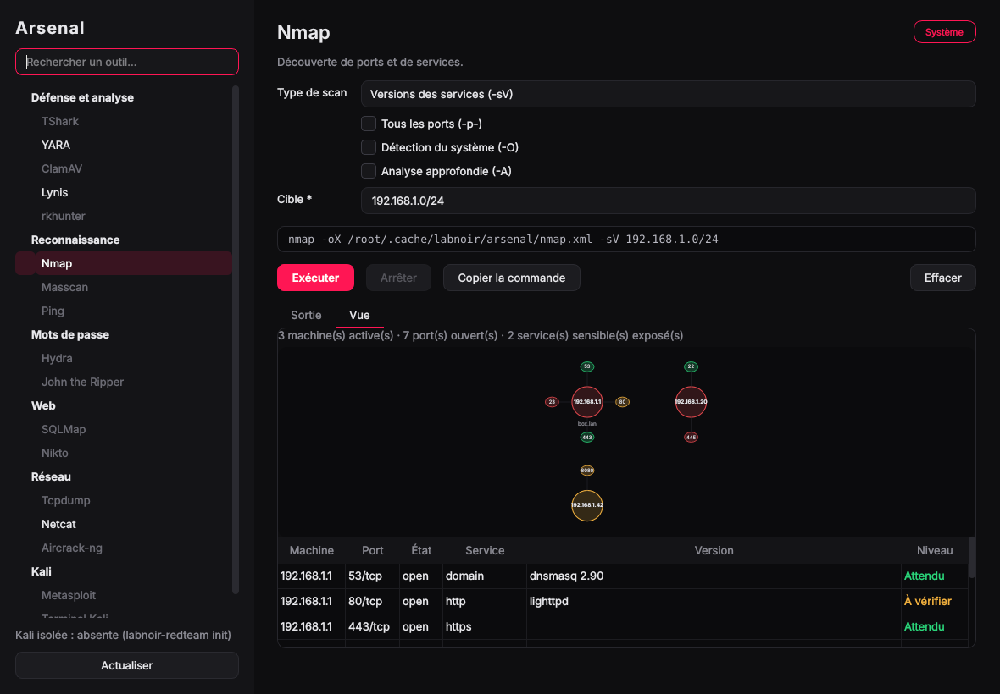
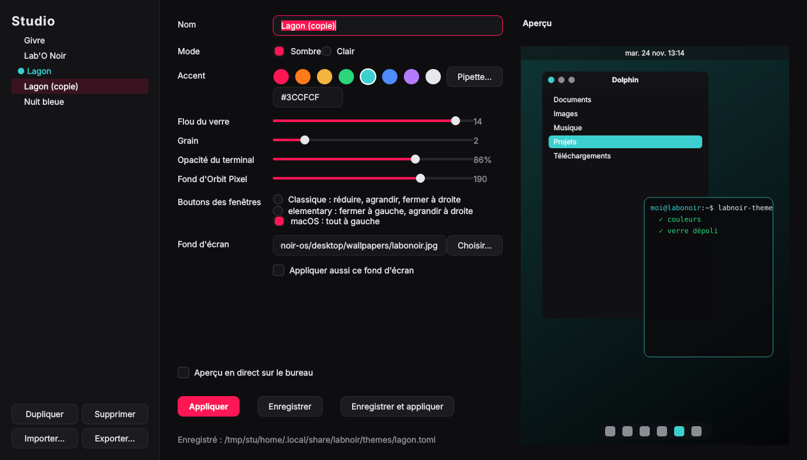

<div align="center">


# Lab'O Noir OS

**Un poste de travail sobre pour les développeurs et la cyberdéfense.**

Debian 13 ou Kubuntu 26.04 · KDE Plasma 6 · outils blue team sur le système, red team isolée

[](https://github.com/D-Goth/labo-noir-os/actions/workflows/ci.yml)
[](LICENSE)

</div>

---

Lab'O Noir n'est pas un « OS de hacker » de série télé. C'est un bureau épuré, agréable au quotidien,
qui cache sous le capot tout ce qu'il faut pour développer, surveiller, auditer et comprendre les attaques.

- **Un bureau soigné** : barre fine en haut, dock flottant, verre dépoli, thèmes à la carte.
- **La défense sur le système, l'attaque à l'écart** : les outils blue team sont installés, la Kali officielle vit dans un conteneur isolé, l'analyse de logiciels malveillants se fait en VM.
- **Des outils lisibles** : Arsenal lance les outils en ligne de commande et dessine leurs résultats.
- **Rien ne sort sans toi** : pas de télémétrie, aucune date de naissance demandée, aucun service de vérification d'âge.

<p align="center">
  
  
</p>

## Sommaire

- [Ce qu'il y a dedans](#ce-quil-y-a-dedans)
- [Installation](#installation)
- [Au quotidien](#au-quotidien)
- [Modules](#modules)
- [Confidentialité](#confidentialité)
- [Questions fréquentes](#questions-fréquentes)
- [Documentation et contribution](#documentation-et-contribution)
- [Licence](#licence)

## Ce qu'il y a dedans

### Le bureau

Plasma 6 dans l'esprit d'elementary OS : une barre fine en haut (menu, menu de l'application active,
horloge centrée, notifications), un dock flottant centré qui s'efface devant les fenêtres, le flou du
verre dépoli sur les panneaux, les menus et le terminal. Les fenêtres gardent leurs boutons réduire,
agrandir et fermer en haut à droite.

Le **Studio Lab'O Noir** règle tout sans toucher un fichier : couleur d'accent, mode sombre ou clair,
force du flou, opacité du terminal, boutons des fenêtres, fond d'écran, avec un aperçu en direct.
Trois thèmes sont fournis (`labonoir`, `nuit-bleue`, `givre`), les tiens s'enregistrent et se partagent.

Le thème va jusqu'au terminal : couleurs et transparence de Konsole, invite à l'accent, et
**cool-retro-term** (le terminal façon vieil écran cathodique) dont le texte prend la couleur du thème.

Les modules **Orbit Pixel** (horloge, système, son, météo) se posent sur le bureau et suivent l'accent du thème.

### Arsenal

Un lanceur graphique pour les outils habituellement en ligne de commande :

- formulaire par outil, aperçu de la commande exacte, sortie en direct, bouton Arrêter ;
- chaque outil tourne **sur le système** ou **dans la Kali isolée**, au choix ou automatiquement ;
- **vues graphiques** des résultats : carte réseau Nmap (machines et ports colorés selon leur sensibilité), jauge et recommandations de Lynis, détections ClamAV et YARA ;
- case **Administrateur** : seule la commande passe en root, Plasma demande ton mot de passe ;
- aucune saisie ne peut injecter de commande : chaque champ reste un argument.

### Défense et red team

| Côté défense, sur le système | Côté attaque, à l'écart |
|---|---|
| Wireshark, TShark, tcpdump, Nmap | Kali officielle dans un conteneur Distrobox |
| Suricata, YARA, ClamAV | Metasploit, Hydra, SQLMap, Masscan… dans la Kali |
| rkhunter, chkrootkit, Lynis, AIDE, auditd | QEMU/KVM et virt-manager pour les VM d'analyse |
| Sleuth Kit, binwalk, foremost, Volatility 3 | |

La Kali se met à jour depuis ses propres dépôts et se recrée en une commande : le système reste une Debian
stable et propre.

### Navigateur

**Zen Browser**, dérivé de Firefox sans télémétrie, installé depuis Flathub et choisi comme navigateur par défaut.

### Développement

Compilateurs C/C++, Python, Node.js, Go, Rust (rustup), Podman, Distrobox, Kate, Neovim, VSCodium,
tmux, direnv, git-lfs.

### Messagerie sans inscription

**SimpleX Chat** (aucun identifiant, pas même un numéro aléatoire) et **Briar** (Tor, Wi-Fi ou Bluetooth,
sans serveur central).

## Installation

### 1. Le système de base

- **Debian 13** : à l'installation, dans « Sélection des logiciels », coche **KDE Plasma** et décoche GNOME ;
- ou **Kubuntu 26.04**.

> **En machine virtuelle**, active l'accélération 3D (virt-manager : affichage Virtio avec 3D ;
> VirtualBox : VMSVGA avec accélération 3D ; VMware : « Accélérer les graphismes 3D »), sinon KWin coupe le flou.
> Compte 4 Go de RAM, 8 avec la Kali. L'installateur ajoute les outils invités : l'écran suit la taille de la fenêtre.

### 2. Lab'O Noir

```bash
sudo apt install git
git clone https://github.com/D-Goth/labo-noir-os.git
cd labo-noir-os

./install.sh --list            # les modules
sudo ./install.sh --dry-run    # tout ce qui serait fait, sans rien toucher
sudo ./install.sh              # installation complète
```

### 3. Première connexion

Ferme puis rouvre ta session : le bureau Lab'O Noir s'applique tout seul à la première connexion.

**Options utiles**

| Option | Effet |
|---|---|
| `--only bureau,arsenal` | n'installe que ces modules |
| `--skip redteam,virtualisation` | saute ces modules (installation plus rapide) |
| `--user NOM` | compte à personnaliser (par défaut : celui qui lance `sudo`) |
| `--yes` | pas de confirmation |

Le journal est dans `/var/log/labnoir-install.log`. Un paquet absent des dépôts est signalé dans le bilan
sans arrêter l'installation, et un module en échec n'empêche pas les autres.

**Mettre à jour** : `git pull`, puis relance `sudo ./install.sh` (ou seulement les modules concernés).

## Au quotidien

| Commande | Rôle |
|---|---|
| `labnoir-studio` | Studio de thèmes (aussi dans le menu des applications) |
| `labnoir-theme list` | Thèmes disponibles |
| `labnoir-theme apply nuit-bleue` | Applique un thème ; ton fond d'écran est gardé (`--fond` pour prendre celui du thème) |
| `arsenal` | Lanceur graphique des outils |
| `labnoir-redteam init` | Crée la Kali isolée (top 10 des outils ; `--full` ou `--large` pour plus) |
| `labnoir-redteam enter` | Ouvre un terminal dans la Kali |
| `labnoir-redteam vm` | Vérifie la virtualisation et ouvre virt-manager |
| `labnoir-privacy` | Vérifie l'absence de date de naissance, de service d'âge et de télémétrie |

Ces commandes se lancent depuis ta session, **sans** `sudo`.

## Modules

| Module | Contenu |
|---|---|
| `base` | Outils de base, Flathub, Zen Browser, outils invités si c'est une VM (VMware, QEMU, VirtualBox), commandes `labnoir-*` |
| `confidentialite` | Télémétrie coupée (Debian, KDE, Ubuntu), garde-fou contre le service de vérification d'âge |
| `bureau` | Plasma 6 façon elementary, verre dépoli, thème, Konsole translucide, écran de connexion, Studio |
| `dev` | Outils de développement |
| `defense` | Outils blue team |
| `redteam` | Kali isolée dans un conteneur Distrobox |
| `virtualisation` | QEMU/KVM et virt-manager |
| `messagerie` | SimpleX Chat et Briar |
| `arsenal` | Lanceur graphique des outils et ses vues |
| `orbit` | Orbit Pixel sur le bureau |
| `durcissement` | Pare-feu (tout refusé en entrée), noyau durci, mises à jour de sécurité automatiques, SSH sans root |

## Confidentialité

Lab'O Noir ne demande jamais de date de naissance et n'installe aucun service de vérification d'âge.
Un réglage D-Bus empêche même un tel service (`org.freedesktop.AgeVerification1`) de s'enregistrer sur le
système. La télémétrie est coupée : popularity-contest sous Debian, retours d'usage de KDE, et sous
Kubuntu apport, whoopsie, ubuntu-report et les actualités du message d'accueil.

`labnoir-privacy` vérifie tout cela à tout moment.

Ces lois visent pour l'instant certains États américains et le Brésil. Si tu redistribues Lab'O Noir,
vérifie les règles qui s'appliquent là où il sera utilisé.

## Questions fréquentes

**Pourquoi les outils offensifs ne sont-ils pas installés directement, comme sur Kali ?**
Mélanger les dépôts Kali et Debian finit presque toujours par casser le système à une mise à jour. Dans un
conteneur, la Kali reste complète et à jour, et le poste reste stable.

**Pourquoi Arsenal ne tourne-t-il pas en root ?**
Une interface graphique entière en root, c'est une grande surface d'attaque, et Wayland refuse de
l'afficher. Arsenal n'élève que la commande qui en a besoin, au moment où elle en a besoin.

**Je n'ai pas de flou.**
KWin a besoin de l'accélération graphique. En VM, active la 3D ; sur une vraie machine, vérifie le pilote graphique.

**Le dock prend toute la largeur.**
Clic droit sur le dock, « Afficher la configuration du panneau » : largeur « Adapter au contenu », style
« Flottant », visibilité « Éviter les fenêtres ».

## Documentation et contribution

- [docs/ARCHITECTURE.md](docs/ARCHITECTURE.md) : organisation du dépôt et choix techniques
- [docs/NOMENCLATURE.md](docs/NOMENCLATURE.md) : chaque code de référence du code, avec sa définition et un extrait
- [ROADMAP.md](ROADMAP.md) : la suite (ISO installable, client bitchat, vues TShark…)

Le code ne contient pas de commentaires explicatifs mais des codes de référence (`# [INS-04]`) définis dans
`docs/nomenclature.toml`. Avant de proposer une modification :

```bash
python3 scripts/nomenclature.py          # régénère docs/NOMENCLATURE.md
python3 scripts/nomenclature.py --check  # ce que vérifie la CI
```

La CI lance aussi ShellCheck, les tests d'Arsenal et du Studio, une simulation complète de l'installation
et la vérification de tous les paquets sur Debian 13 et Kubuntu 26.04.

## Licence

Le code est sous **GPL-3.0** ([LICENSE](LICENSE)). Le nom Lab'O Noir, le logo, le fond d'écran et la
charte graphique restent réservés : voir [BRANDING.md](BRANDING.md).

<div align="center">
<sub>Lab'O Noir OS · <a href="https://black-lab.fr">Black-Lab</a> · D-Goth</sub>
</div>
